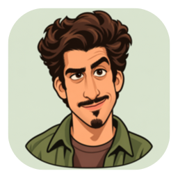
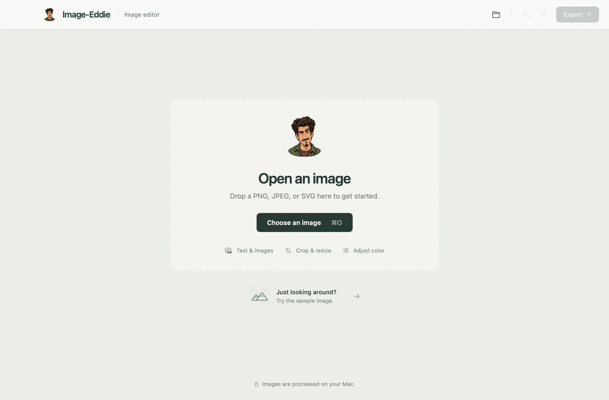
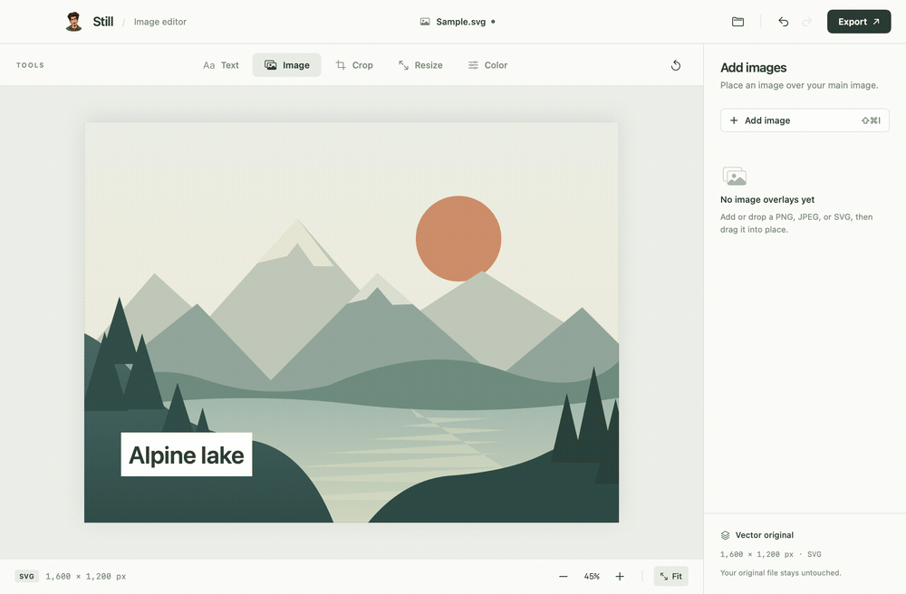
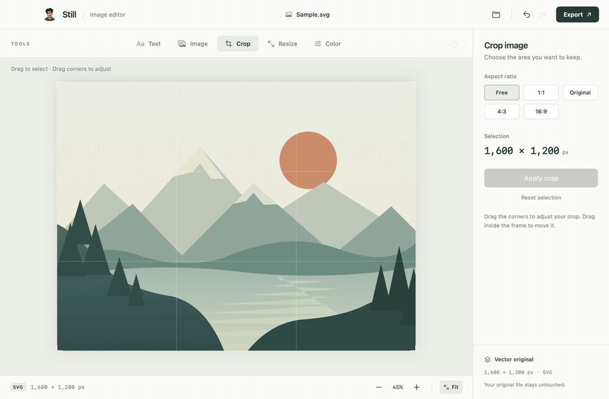
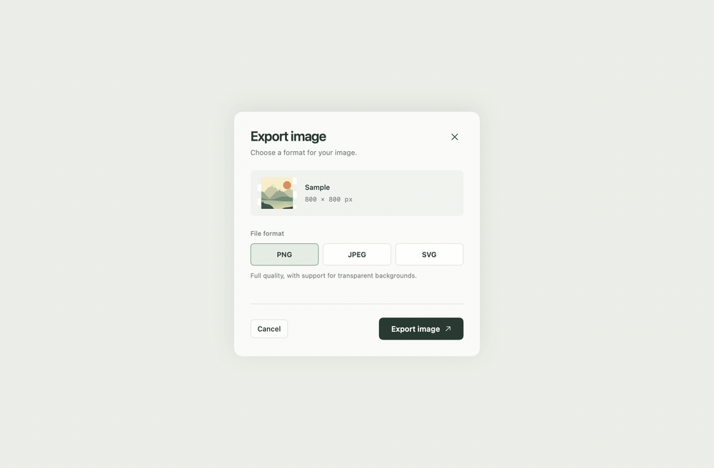

# Still

A simple, native macOS image editor for **PNG, JPEG, and SVG**. Add text and image overlays, crop, resize, adjust colors, and export. Everything happens on your Mac.

Built with SwiftUI, AppKit, Core Image, and ImageIO. No accounts, subscriptions, or external package dependencies.

## Install from source

### Requirements

- **macOS 14 or later**, on Apple silicon or Intel.
- **Swift 6 or later** and the macOS SDK, available with Xcode 16+ or a compatible version of Apple's Command Line Tools.
- Git, included with Apple's developer tools.

If you don't have the developer tools, run this and finish Apple's installer:

```sh
xcode-select --install
```

Check the selected compiler with `swift --version`; it should report Swift 6 or newer. If you already have full Xcode installed, make sure it is selected in **Xcode → Settings → Locations → Command Line Tools**.

### Build and open

```sh
git clone https://github.com/nbnm/image-ed.git
cd image-ed
./scripts/build-app.sh
open build/Still.app
```

The build script creates **`build/Still.app`**, including its character artwork, macOS icon, and sample SVG. It signs the app locally and builds for the architecture of your Mac.

To keep the app installed, drag `build/Still.app` into your **Applications** folder. Or install it in your own Applications folder from the terminal:

```sh
mkdir -p "$HOME/Applications"
ditto build/Still.app "$HOME/Applications/Still.app"
open "$HOME/Applications/Still.app"
```

These instructions build and sign the app on your own Mac. Packaging it for other people's Macs requires an appropriate Apple Developer signing and notarization process.

## How it works

Open an image with **⌘O**, drag a file into the window, or click **Try the sample image**. Choose a tool above the canvas; its controls appear on the right.

### Add text

Click **Text → Add text** or press **⇧⌘T**. Type your label, choose a font, size, and color, then drag it into position. Use **White box** for a solid background or **Transparent** for text directly over the image.



### Overlay images

Click **Image → Add image** or press **⇧⌘I** to add one or more PNG, JPEG, or SVG files. While the Image tool is selected, dropping files adds overlays.

Drag an overlay to move it, drag a corner to resize it proportionally, or use the **Size** slider. Adjust **Opacity**, use the arrows to change the image layer order, or delete an overlay with the trash button. Image overlays sit above the original image and below text.



### Crop, resize, and adjust colors

- **Crop:** drag the crop corners, choose a free or fixed aspect ratio, then click **Apply crop**. Choose **1:1** for a square.
- **Resize:** enter pixel dimensions or choose a quick scale, then click **Apply size**. Proportions are linked by default.
- **Color:** choose Original, B&W, Noir, Warm, Cool, or Sepia. Fine-tune brightness, contrast, and saturation.

Cropping clips the whole composition, including text and image overlays. Resizing scales the composition. Color adjustments apply to the main image.



### Export

Click **Export** or press **⇧⌘E**. Choose your format, click **Export image**, and choose a destination in the native save dialog.

| Format | Use it for |
| --- | --- |
| **PNG** | Lossless output with transparent areas preserved. |
| **JPEG** | Smaller files for sharing. Set quality from 10–100% and choose a background color for transparent areas. |
| **SVG** | Scalable source artwork and text. Raster images are embedded; SVG image overlays stay vector. |



## Editing and shortcuts

Edits remain in memory until you export. The original file is not overwritten automatically, and Still warns before discarding unexported changes. Undo and redo work across tools, including image overlay changes.

| Shortcut | Action |
| --- | --- |
| **⌘O** | Open an image |
| **⇧⌘T** | Add text |
| **⇧⌘I** | Add an image overlay |
| **⇧⌘E** | Export |
| **⌘Z** / **⇧⌘Z** | Undo / redo |
| **⌘0** / **⌘1** | Fit image / actual size |

## Format details and limits

- Phone photos are opened with their EXIF orientation applied.
- PNG and JPEG exports render SVG artwork at the requested resolution.
- SVG exports preserve the original vector paths, text, and SVG overlays. Raster sources and overlays are embedded as PNG images.
- SVG color adjustments are written into paint, gradient, and embedded-image colors instead of SVG filter elements, so the result also works in macOS's SVG decoder. Strong adjustments can produce small gradient differences from the raster preview.
- Input files are limited to **150 MB**, **16,384 pixels per side**, and **64 million pixels total**.
- Use self-contained SVGs. External fonts, linked files, scripts, and browser-specific features are outside the macOS image decoder's supported scope. SVG text uses installed fonts.

## Development

For a faster debug build:

```sh
./scripts/build-app.sh --debug
open build/Still.app
```

Run the verification suite:

```sh
./scripts/verify.sh
```

The 19 checks cover exports, transparency, photo orientation, crop coordinates, text placement, filters, SVG round trips, overlay compositing and layer order, and undo/redo. They work with Command Line Tools alone; XCTest and full Xcode are not required.

### Regenerate the walkthrough GIFs

With Swift and FFmpeg available:

```sh
./scripts/generate-demos.sh
```

This renders the app's actual native views using the bundled sample artwork and character logo, then creates the GIFs in `docs/media/`. Raw frames stay in the ignored `build/docs-capture/` directory. No desktop recording or personal files are used.

## Character artwork

The logo and icon are an illustrated remake of Eddie from *Friends*. Source artwork and the built-in image generation prompts are in [Resources/Brand](Resources/Brand). The icon build creates all ten standard macOS icon representations and automatically regenerates them when the master artwork or icon script changes.
